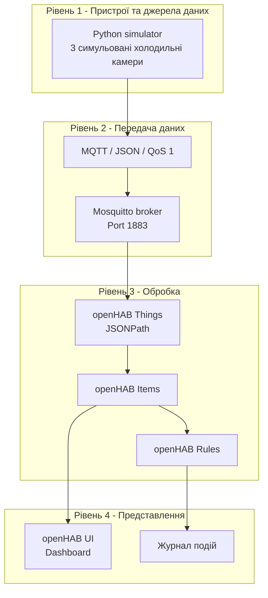

# Система моніторингу промислової холодильної лінії


## Опис системи
Проєкт реалізує демонстраційну систему моніторингу трьох холодильних камер для сценарію зберігання фармацевтичної продукції. Python-симулятор генерує тестові показники температури, стану дверей, живлення, компресора та тривоги. Дані передаються через MQTT-брокер Mosquitto до openHAB, де вони відображаються на панелі моніторингу та обробляються правилами автоматизації.
Система запускається в Docker-контейнерах.

## Архітектура системи
Архітектура поділена на чотири логічні рівні:



Потік даних: симулятор генерує показники → Mosquitto передає MQTT-повідомлення → openHAB отримує й перетворює дані → Items зберігають поточні стани → Rules перевіряють умови → користувач бачить результати у вебінтерфейсі.

## Пристрої та програмні компоненти

| Компонент | Призначення |
|---|---|
| coldroom1 | Симуляція першої холодильної камери |
| coldroom2 | Симуляція другої холодильної камери |
| coldroom3 | Симуляція третьої холодильної камери |
| Python simulator | Генерація тестових показників і JSON-повідомлень |
| Mosquitto | MQTT-брокер для обміну даними |
| openHAB | Моніторинг, Items, Rules та вебінтерфейс |
| Docker Compose | Запуск контейнерів і налаштування їхньої взаємодії |

У цій демонстраційній версії використовуються симульовані, а не фізичні датчики. Значення живлення в симуляторі завжди справне, а стан компресора визначається спрощеною умовою за температурою.

## Де обробляються дані

Обробка переважно виконується локально, на edge-рівні - на комп’ютері, де запущені Docker-контейнери. Python-симулятор формує тестові значення, Mosquitto передає повідомлення, а openHAB витягує потрібні поля JSON, оновлює Items і виконує правила.

Окремої хмарної платформи немає. Самостійний fog-рівень також не використовується. Такий підхід спрощує розгортання й демонстрацію системи та не вимагає зовнішнього хмарного сервісу.

## Чому MQTT
Для цього варіанта обрано MQTT завдяки невеликим накладним витратам, моделі публікації/підписки та підтримці QoS 1 і retained-повідомлень, що зручно для періодичної телеметрії кількох камер. HTTP зазвичай потребує запитів або додаткової логіки опитування, тоді як MQTT дає змогу брокеру передавати оновлення підписникам. CoAP також підходить для обмежених пристроїв, але в цьому проєкті вже використовується MQTT-інтеграція openHAB. Zigbee потребував би відповідної бездротової мережі та шлюзу, а LoRaWAN краще підходить для далекого зв’язку з малим обсягом даних, ніж для локальної телеметрії в Docker. Це вибір для поточного демонстраційного сценарію, а не універсальна перевага MQTT над іншими протоколами.

## MQTT-топіки

| Топік | Дані | QoS | Retained |
|---|---|---:|---|
| `warehouse/coldroom1/telemetry` | Телеметрія першої камери | 1 | Так |
| `warehouse/coldroom2/telemetry` | Телеметрія другої камери | 1 | Так |
| `warehouse/coldroom3/telemetry` | Телеметрія третьої камери | 1 | Так |
| `warehouse/coldroom1/status` | Стан симулятора | 1 | Так |
| `warehouse/coldroom2/status` | Стан симулятора | 1 | Так |
| `warehouse/coldroom3/status` | Стан симулятора | 1 | Так |

Приклад повідомлення telemetry:

```json
{
  "timestamp": "2026-01-01T12:00:00+00:00",
  "room": "coldroom1",
  "temperature_c": 4.2,
  "door_open": false,
  "power_ok": true,
  "compressor_on": false,
  "alarm": false
}
```

QoS 1 означає доставку щонайменше один раз, тому можливі дублікати. Retained дозволяє брокеру зберігати останнє retained-повідомлення топіка для нових підписників.

Примітка: симулятор публікує топіки status, але наведений конфігураційний фрагмент coldstorage.things підписаний лише на telemetry.

## Правила моніторингу

| Подія | Умова | Реакція |
|---|---|---|
| Температура камери 1 | Вище 5 °C і не вище 8 °C | Інформаційне попередження в журналі |
| Температура камери 1 | Вище 8 °C | Критичне попередження в журналі |
| Температура камери 2 | Вище 5 °C і не вище 8 °C | Інформаційне попередження в журналі |
| Температура камери 2 | Вище 8 °C | Критичне попередження в журналі |
| Температура камери 3 | Вище 5 °C і не вище 8 °C | Інформаційне попередження в журналі |
| Температура камери 3 | Вище 8 °C | Критичне попередження в журналі |
| Двері будь-якої камери | Item дверей змінюється на `ON` | Попередження про відкриті двері |

Температурні правила запускаються при зміні відповідного Item. Повідомлення записуються в журнал openHAB. SMS, електронна пошта та push-сповіщення цими правилами не реалізовані.

## Вимоги

- Docker Desktop із запущеним Docker Engine.
- Docker Compose, доступний через команду docker compose.
- Вільні порти 1883 та 8080.
- Файли проєкту й конфігурації.

## Запуск і зупинка
Відкрийте PowerShell у кореневій папці проєкту.

### Запуск
```powershell
docker compose up -d
```

### Перевірка контейнерів
```powershell
docker compose ps
```

### Відкрити openHAB
Перейдіть за адресою: http://localhost:8080

### Переглянути журнали всіх сервісів
```powershell
docker compose logs --tail 100
```

### Переглянути журнал симулятора
```powershell
docker logs --tail 50 cold-simulator-simple
```

### Переглянути журнал Mosquitto
```powershell
docker logs --tail 50 cold-mosquitto-simple
```

### Переглянути журнал openHAB
```powershell
docker logs --tail 50 cold-openhab-simple
```

### Перезапустити проєкт
```powershell
docker compose down
docker compose up -d
```

## Перевірка роботи
Якщо mosquitto_sub доступний у контейнері брокера, можна переглянути шість повідомлень телеметрії:

```powershell
docker exec cold-mosquitto-simple mosquitto_sub -h localhost -t "warehouse/+/telemetry" -C 6 -v
```

Перевірити повідомлення правил у журналі openHAB:

```powershell
docker exec cold-openhab-simple bash -lc grep -i coldstorage /openhab/userdata/logs/openhab.log | tail -n 30
```

Для перевірки аварійного правила має відбутися реальне перевищення порога й зміна відповідного Item.

## Скріншоти


## Основні файли проєкту

| Файл | Призначення |
|---|---|
| `docker-compose.yml` | Контейнери, мережі, томи та параметри запуску |
| `mosquitto.conf` | Конфігурація MQTT-брокера |
| Python-файл симулятора | Генерація телеметрії та публікація MQTT-повідомлень |
| `coldstorage.things` | MQTT Bridge, Things, канали та JSONPath |
| `coldstorage.items` | Items температури та станів |
| `coldstorage.rules` | Правила температурного моніторингу й дверей |
| `architecture.md` | Опис архітектури системи |
